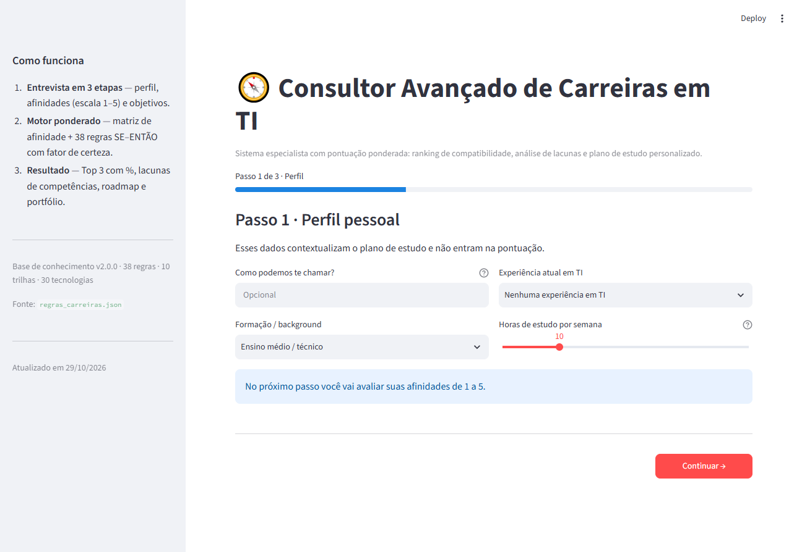
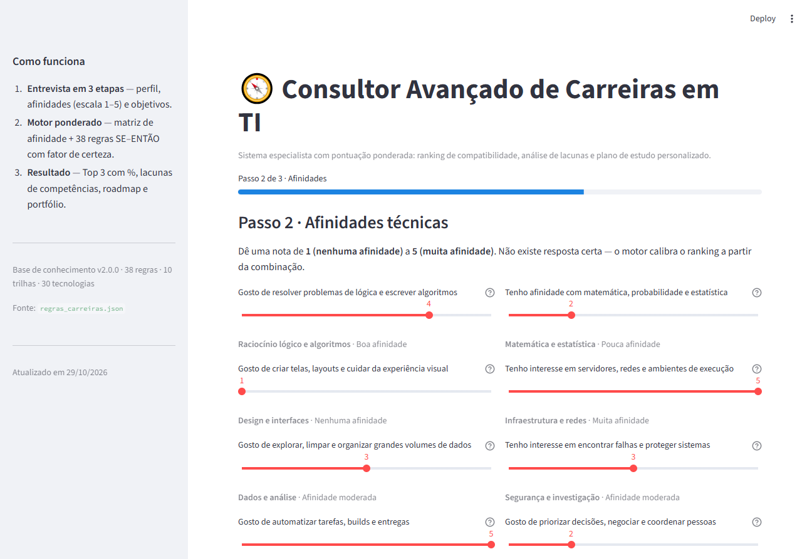
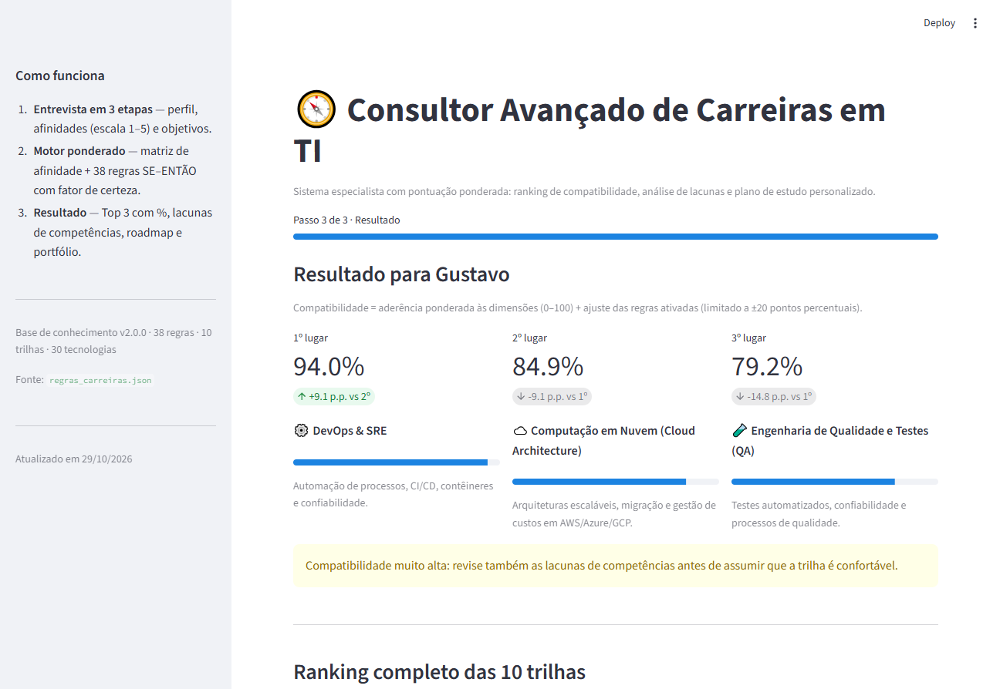
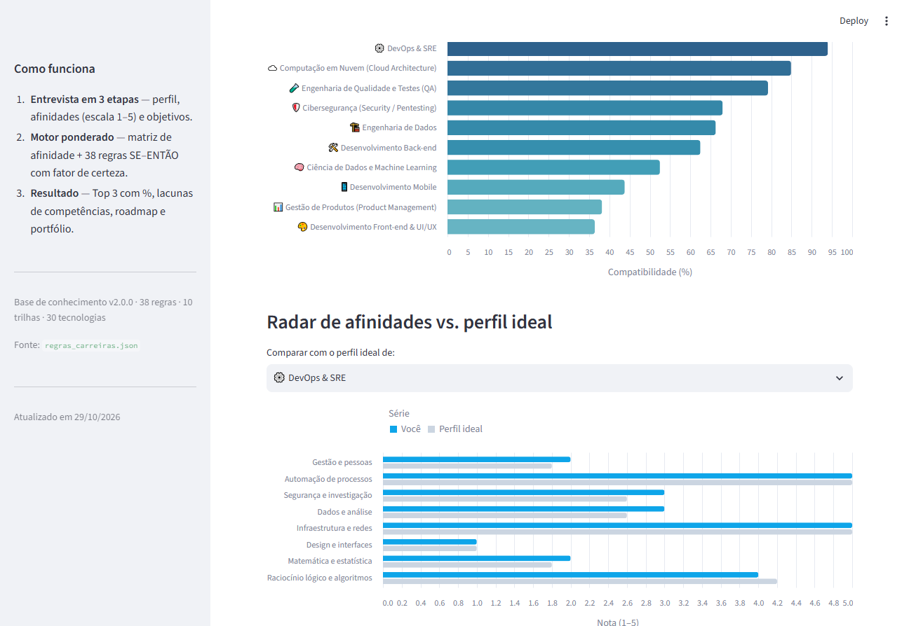
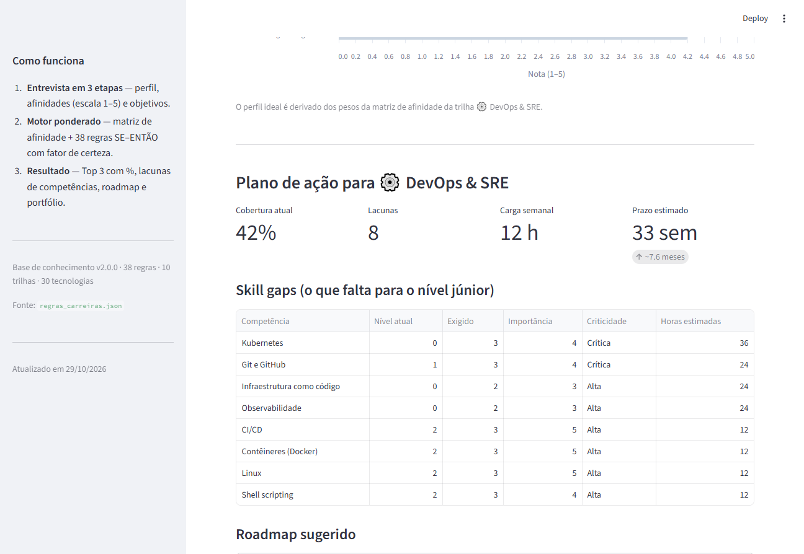
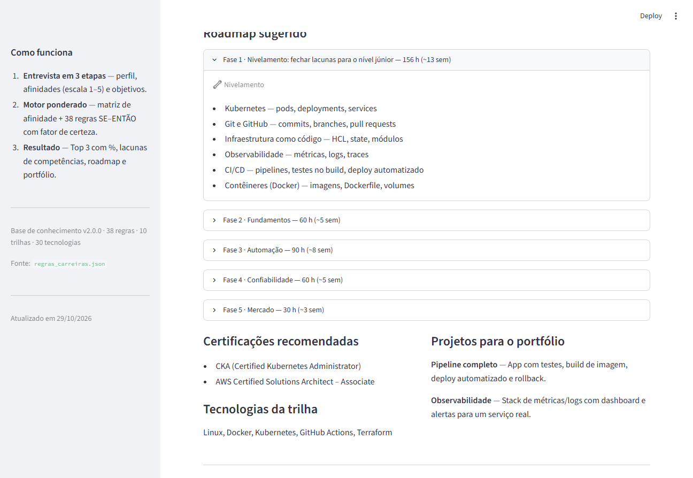

# 🧭 Consultor Avançado de Carreiras em TI

**Sistema especialista baseado em regras, com pontuação ponderada e tratamento de incerteza.**
Entrevista o usuário em três etapas e devolve o **Top 3 de trilhas com percentual de compatibilidade**,
a **justificativa de cada ponto**, a **análise de lacunas (skill gaps)** para o nível júnior e um
**roadmap personalizado** com certificações e projetos de portfólio.


---

## 📌 O problema

Escolher uma trilha em TI não é uma decisão binária: quase ninguém "gosta" ou "não gosta" de dados,
de infraestrutura ou de design — as pessoas têm **graus de afinidade** e, muitas vezes, interesses
que apontam para caminhos diferentes ao mesmo tempo.

Este projeto implementa um sistema especialista que:

| Requisito | Como foi resolvido |
|---|---|
| Entrada gradual | 8 dimensões em **escala Likert 1–5** (lógica, matemática, visual, infra, dados, segurança, automação, gestão) |
| Ranking com percentual | matriz de afinidade ponderada + regras → **% de compatibilidade das 10 trilhas** |
| Justificativa transparente | cada trilha mostra a **parcela da matriz** e as **regras SE–ENTÃO ativadas** |
| Incerteza | cada regra tem **fator de certeza** (0–1) e o ajuste total é **limitado a ±20 p.p.** |
| Ambiguidade | alertas de **empate técnico**, perfil pouco definido e respostas uniformes |
| Skill gaps | comparação das competências exigidas (nível júnior) com o que o usuário já estudou/domina |
| Roadmap | fases ordenadas, horas estimadas, prazo em semanas conforme a carga horária semanal |
| Base desacoplada | tudo vive em `data/regras_carreiras.json` — **nada hardcoded no motor** |

---

## 🖼️ Demonstração

| Passo 1 — Perfil | Passo 2 — Afinidades (Likert) |
|---|---|
|  |  |

| Resultado — Top 3 com justificativa |
|---|
|  |

| Ranking completo + radar vs. perfil ideal | Skill gaps e cobertura |
|---|---|
|  |  |

| Roadmap, certificações e portfólio |
|---|
|  |

No resultado também há a seção **"Como o motor chegou a esse resultado"**, com a tabela de
contribuição de cada dimensão e todas as regras ativadas — e um botão para **baixar o resultado em JSON**.

---

## 🚀 Como executar

Requisitos: **Python 3.10+**. Nenhum passo de configuração além dos comandos abaixo —
a base de conhecimento é localizada a partir do próprio código, então funciona de qualquer
diretório de trabalho.

```bash
# 1. (opcional, recomendado) ambiente virtual
python -m venv .venv
# Windows
.venv\Scripts\activate
# Linux/macOS
source .venv/bin/activate

# 2. dependências (inclui o pytest)
pip install -r requirements.txt

# 3. interface web
streamlit run app.py
```

A aplicação abre em `http://localhost:8501`.

### Testes

`requirements.txt` já traz o `pytest`, então basta:

```bash
pytest
```

```
90 passed
```

> Verificado em uma instalação limpa: `git clone` + `python -m venv` + `pip install -r requirements.txt`
> + `pytest` (90 passed) + `streamlit run app.py` sem erros no console do navegador.

### Diagnóstico por linha de comando

```bash
python tools/avaliar_personas.py          # roda as 13 personas e imprime o ranking
python tools/avaliar_personas.py gustavo  # apenas uma persona
python tools/gerar_docs.py                # regenera docs/Base_de_Conhecimento.md a partir do JSON
```

---

## 🧠 Como o motor calcula

### 1. Aderência base (matriz de afinidade)

Cada dimensão `d` tem um peso `peso(d, t)` para cada trilha `t` (0 a 5). A resposta é normalizada:

```
n_d = (resposta_d - 1) / (5 - 1)          → 0 (nenhuma afinidade) a 1 (muita afinidade)

base(t) = 100 × Σ_d [ peso(d,t) × n_d ] / Σ_d peso(d,t)
```

Com todas as respostas neutras (3), **toda trilha fica em 50%** — o ponto de partida sem viés.
Quem responde 5 em tudo chega a 100%; o que diferencia as trilhas é o **padrão** de respostas.

### 2. Regras ponderadas (tratamento de incerteza)

As **38 regras** do JSON seguem o formato:

```json
{
  "id": "R10",
  "nome": "Infraestrutura com automação",
  "tipo": "reforco",
  "certeza": 0.9,
  "condicoes": [
    { "fonte": "infra", "op": ">=", "valor": 4 },
    { "fonte": "automacao", "op": ">=", "valor": 4 }
  ],
  "efeitos": [
    { "trilha": "devops", "delta": 7 },
    { "trilha": "cloud",  "delta": 4 }
  ],
  "explicacao": "Automatizar infraestrutura é a essência de DevOps/SRE."
}
```

Há três tipos de regra:

- **reforço (25)** — combinações que fortalecem uma trilha;
- **desambiguação (7)** — separa pares confusos (Ciência × Engenharia de Dados, DevOps × Cloud, Front-end × Mobile, QA × Back-end, Produto × perfis técnicos);
- **penalidade (6)** — evita recomendações incoerentes (ex.: querer IA com matemática nota 1).

O efeito aplicado é `delta × certeza`, somado por trilha e **limitado a ±20 pontos percentuais**:

```
ajuste(t) = clamp( Σ_regras (delta × certeza), -20, +20 )
compat(t) = clamp( 0, 100, base(t) + ajuste(t) )
```

O limite garante que as regras **não invertam** um perfil muito desalinhado: elas refinam o ranking,
não o sequestram.

### 3. Exemplo real (persona "Gustavo", perfil DevOps)

| Etapa | Valor |
|---|---|
| Aderência da matriz | 77,5% |
| R10 Infraestrutura + automação | +6,30 p.p. |
| R11 Automação + Linux | +5,95 p.p. |
| R12 Infraestrutura + objetivo de escala | +2,70 p.p. |
| R19 Automação + processo | +1,60 p.p. |
| **Compatibilidade final** | **77,5 + 16,55 = 94,0%** |
| 2º lugar | Cloud Architecture — 84,9% |

### 4. Empates e incerteza

- margem entre 1º e 2º **< 3 p.p.** → alerta de **empate técnico** (sugere experimentar as duas trilhas);
- melhor trilha **< 45%** → alerta de **perfil pouco definido**;
- todas as respostas iguais → alerta de **respostas uniformes**;
- ≥ 15 regras ativadas → alerta de **perfil multifacetado**;
- empate absoluto é resolvido por: maior aderência da matriz → ordem canônica das trilhas (determinístico).

---

## 🧩 Skill gaps e roadmap

1. As tecnologias marcadas como **"já estudei"** viram nível **2** nas competências que elas comprovam;
   **"domino"** vira nível **4** (`data/regras_carreiras.json → tecnologias`).
2. Cada trilha exige um **nível júnior** por competência (1–5) com um grau de **importância**.
3. A **lacuna** é `max(0, exigido − atual)`; a prioridade é `lacuna × importância`, o que gera a
   criticidade (`Crítica`, `Alta`, `Moderada`, `Leve`).
4. A **cobertura** da trilha é a média ponderada de `min(atual/exigido, 1)`.
5. O roadmap é montado com a fase de **nivelamento** (lacunas, a `12 h` por nível) seguida das fases
   da trilha (fundamentos → prática → portfólio → mercado).
6. O prazo é `Σ horas ÷ horas de estudo por semana` (mínimo de 1 semana por fase).

---

## 🗂️ Trilhas cobertas

| # | Trilha | Foco |
|---|---|---|
| 1 | 🛠️ Desenvolvimento Back-end | APIs, regras de negócio, bancos de dados |
| 2 | 🎨 Front-end & UI/UX | interfaces, design system, acessibilidade |
| 3 | 🧠 Ciência de Dados e ML | estatística, modelagem preditiva, visualização |
| 4 | 🏗️ Engenharia de Dados | ETL/ELT, modelagem dimensional, pipelines |
| 5 | 🛡️ Cibersegurança | redes, pentest, criptografia, resposta a incidentes |
| 6 | ⚙️ DevOps & SRE | CI/CD, contêineres, observabilidade, SLOs |
| 7 | ☁️ Cloud Architecture | arquitetura, escalabilidade, FinOps |
| 8 | 📱 Desenvolvimento Mobile | Flutter/React Native, publicação nas lojas |
| 9 | 🧪 QA | testes manuais e automatizados, qualidade no pipeline |
| 10 | 📊 Product Management | discovery, priorização, métricas de produto |

Cada trilha tem: resumo, atividades típicas, tecnologias, **7–8 competências com nível júnior**,
roadmap de 4 fases, **2 certificações** e **2 projetos de portfólio**.

---

## 🏗️ Arquitetura

```
consultor-carreiras-pro/
├── app.py                          # interface Streamlit (wizard de 3 passos + resultado)
├── data/
│   └── regras_carreiras.json       # BASE DE CONHECIMENTO (dimensões, matriz, 38 regras, trilhas)
├── consultor_pro/
│   ├── base_conhecimento.py        # carregamento tipado + validação de consistência
│   ├── motor.py                    # pontuação ponderada, regras, alertas, ranking
│   └── recomendacao.py             # skill gaps, cobertura, roadmap
├── tests/
│   ├── personas.py                 # 13 personas de validação (incluindo casos-limite)
│   ├── test_motor.py               # 44 testes (cálculo, bordas, JSON externo)
│   ├── test_recomendacao.py        # 11 testes (gaps, cobertura, prazos)
│   ├── test_personas.py            # 29 testes (personas + consistência)
│   └── test_app.py                 # 6 testes de interface (Streamlit AppTest)
├── docs/
│   ├── Base_de_Conhecimento.md     # GERADO do JSON (matriz + 38 regras + trilhas)
│   ├── Relatorio.md                # relatório das 5 fases do trabalho
│   └── img/                        # capturas de tela
├── tools/
│   ├── avaliar_personas.py         # CLI de diagnóstico
│   └── gerar_docs.py               # gera a documentação a partir do JSON
├── conftest.py
├── pytest.ini
└── requirements.txt
```

**Fluxo:** `perguntas (JSON) → respostas (dict) → MotorInferencia → Resultado → recomendar.analisar → PlanoAcao → interface`.

---

## 📚 Base de conhecimento (JSON)

Todo o conhecimento está em [`data/regras_carreiras.json`](data/regras_carreiras.json) e a
documentação é **gerada a partir dele** em [`docs/Base_de_Conhecimento.md`](docs/Base_de_Conhecimento.md):

- **dimensões** — id, nome, pergunta, ajuda e etapa;
- **categóricas** — linguagem, entrega, objetivo, estilo (com rótulos);
- **matriz_afinidade** — peso de cada dimensão para cada uma das 10 trilhas;
- **regras** — condições, efeitos, certeza e explicação em linguagem natural;
- **competencias** — catálogo de 43 skills com tópicos de estudo;
- **tecnologias** — 30 tecnologias e as competências que comprovam;
- **trilhas** — competências exigidas, roadmap, certificações, projetos.

O carregador **valida a consistência** (matriz completa, trilhas e fontes existentes, operadores
válidos, certeza entre 0 e 1, skills referenciadas) e falha com mensagem clara se o JSON quebrar:

```python
from consultor_pro import carregar

base = carregar()          # levanta ErroBaseConhecimento se algo estiver inconsistente
base.trilhas["devops"].nome
```

---

## ✅ Validação (Fase 5)

13 personas cobrem as 10 trilhas e três casos-limite. A suíte `pytest` verifica o 1º lugar esperado,
o intervalo dos percentuais, o limite das regras, a geração do plano e a interface.

| Persona | Perfil | 1º lugar | % | 2º lugar | % |
|---|---|---|---|---|---|
| Ana | matemática + dados + IA | 🧠 Ciência de Dados | 88,8 | 🏗️ Engenharia de Dados | 61,6 |
| Bruno | redes + investigação | 🛡️ Cibersegurança | 84,2 | ☁️ Cloud | 63,4 |
| Carla | visual + JavaScript | 🎨 Front-end | 80,1 | 📱 Mobile | 59,4 |
| Diego | gestão + negócio | 📊 Produto | 67,1 | 🎨 Front-end | 40,9 |
| Eduardo | lógica + APIs | 🛠️ Back-end | 65,5 | 🧠 Ciência de Dados | 52,5 |
| Fernanda | dados + infra + automação | 🏗️ Engenharia de Dados | 95,0 | 🧪 QA | 83,7 |
| Gustavo | infra + automação + Linux | ⚙️ DevOps | 94,0 | ☁️ Cloud | 84,9 |
| Helena | infra + escala, pouca automação | ☁️ Cloud | 68,4 | ⚙️ DevOps | 60,1 |
| Igor | visual + mobile | 📱 Mobile | 68,8 | 🎨 Front-end | 61,4 |
| Juliana | lógica + método + testes | 🧪 QA | 60,1 | 🛠️ Back-end | 54,9 |
| **Karina** | dados **e** interface (ambígua) | 🧠 Ciência de Dados | 70,8 | 🎨 Front-end | **70,5** |
| **Leandro** | todas as notas 1 (indefinido) | 🛠️ Back-end | 0,0 | — | — |
| **Marcos** | quer IA, matemática nota 1 | 🏗️ Engenharia de Dados | 78,9 | 🧪 QA | 74,8 |

Casos-limite tratados explicitamente:

- **Karina** → margem de **0,3 p.p.** entre 1º e 2º: o sistema emite *"Empate técnico"* e recomenda
  experimentar as duas trilhas.
- **Leandro** → nenhuma afinidade declarada: 0% em todas, com alertas de *perfil pouco definido*,
  *respostas uniformes* e *nenhuma regra ativada* (sem exceções ou divisão por zero).
- **Marcos** → a regra **P01** (`matemática ≤ 2` + objetivo de IA) aplica **−10 p.p.** em Ciência de
  Dados e a trilha deixa de ser a recomendação, mostrando que as penalidades funcionam.

---

## ⚠️ Limitações

- Os pesos foram calibrados por especialista e validados com personas; **não** foram aprendidos de
  dados reais (não há dataset público rotulado de "trilha ideal").
- O percentual é um **índice de aderência ao perfil**, não uma probabilidade de sucesso profissional.
- O nível das competências vem de autoavaliação por tecnologia, não de avaliação técnica formal.
- A base é estática: mercado, salários e tecnologias mudam e exigem revisão periódica do JSON.

## 🔭 Próximos passos

- Aprendizado dos pesos a partir de respostas reais (ex.: regressão logística sobre escolhas efetivas).
- Módulo de comparação de duas trilhas lado a lado.
- Exportação do roadmap em PDF/Markdown para acompanhamento.
- Tradução da base para inglês e testes de usabilidade com estudantes.

---

## 📄 Documentos

- [`docs/Base_de_Conhecimento.md`](docs/Base_de_Conhecimento.md) — matriz, regras e trilhas (gerado do JSON)
- [`docs/Relatorio.md`](docs/Relatorio.md) — relatório das 5 fases, metodologia e resultados

## 👤 Autor

**Matheus Lima** — <mathioslima1@gmail.com>
